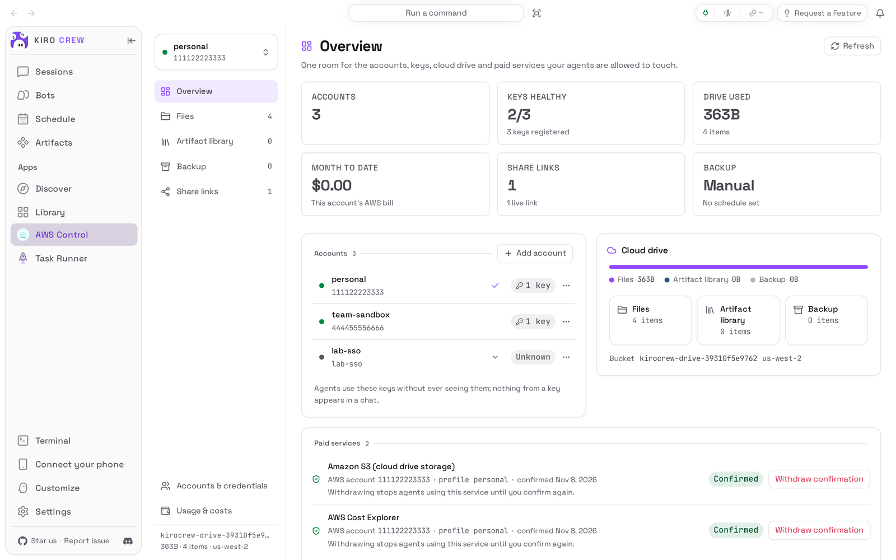
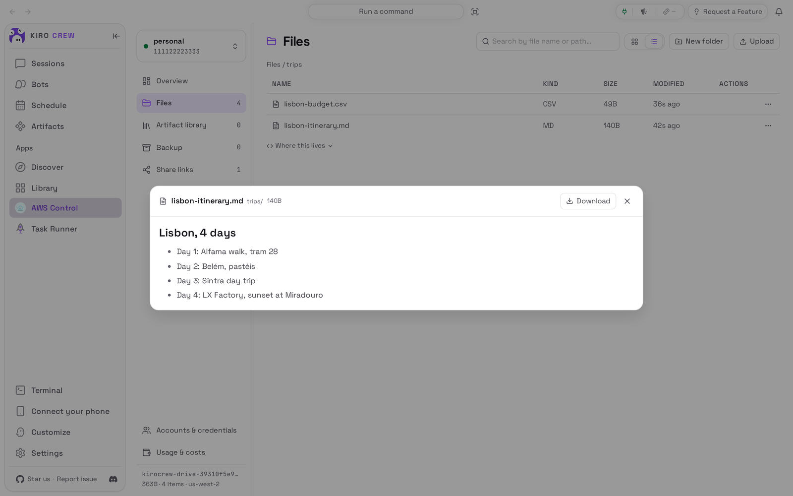
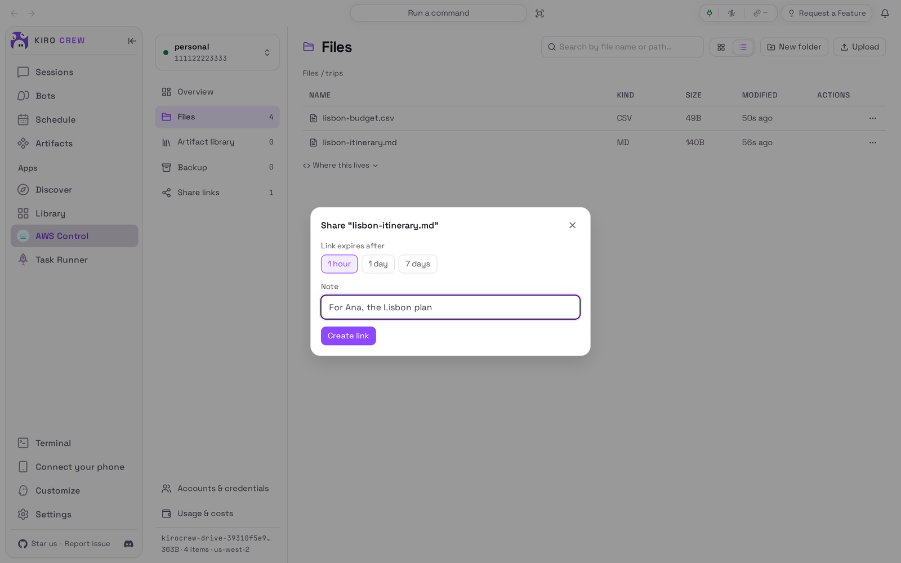
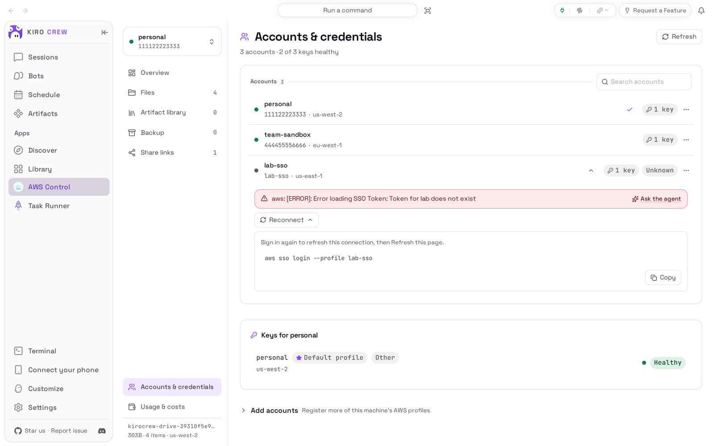
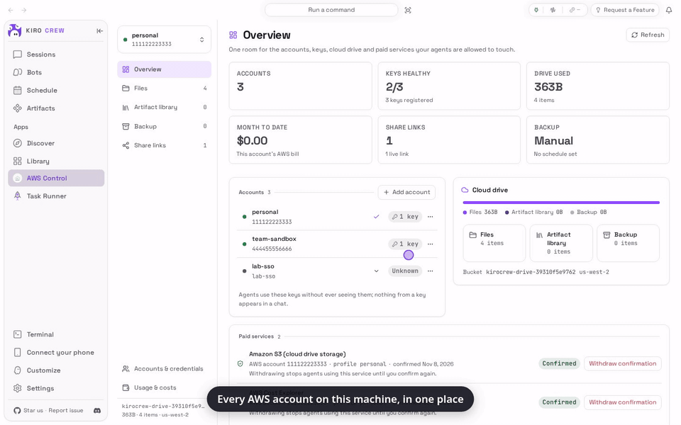

# AWS Control

<picture>
  <source media="(prefers-color-scheme: dark)" srcset="docs/media/hero-dark.png">
  
</picture>

**Your AWS accounts, a private cloud drive and backups, in plain language.**

AWS Control is an app for [Kiro Crew](https://github.com/kirodotdev/KiroCrew),
the open-source personal AI agent.

## What it is

AWS Control adds an **AWS Control** page to Kiro Crew's sidebar. It lists the AWS
accounts this computer can use, with a health light for every key and the exact
steps to reconnect one whose sign-in lapsed, and it turns a storage bucket in your
own account into a private, encrypted, versioned drive: **Files**, an **Artifact
library** for your Kiro Crew artifacts, and **Backup** of Kiro Crew itself, with
share links that always expire. Nothing is public unless you share it, and each
service AWS charges for asks you to confirm it, per account, before its first use.

**Get started:** Open **Apps → Library**, open the **⋯** menu on **AWS Control** and
choose **Enable** (see [Install](#install)).

## The problem it solves

You have a few AWS accounts on this computer (a personal one, a work sandbox, one
you sign in to through your company), and you cannot tell at a glance which keys
still work, what this month is costing you, or where to keep files and backups that
stay yours. The AWS console answers each question on a different page, and only
once you are signed in. AWS Control answers them on one page, using the profiles
already on this computer. It never creates anything in your account, or calls a
service that bills, until you have said yes on screen.

## Top 3 use cases

### 1. Keep files in a bucket you own, and read them without downloading

You want your travel plans, notes and recipes somewhere private that is not a
shared photo app. Once the drive is set up (see [First run](#first-run)), **Files**
works like a folder: **Upload**, **New folder**, rename, move, delete, and
search by name. Choosing a text, markdown, CSV or JSON file opens a preview right
in the page; pictures, video, audio and PDFs preview too.



### 2. Share one file for an hour, a day or a week

A friend needs your itinerary. In **Files**, open the **⋯** menu on the file, choose
**Share**, pick **1 hour**, **1 day** or **7 days**, add a note saying who it is
for, and choose **Create link**. **Share links** lists every link with its note and
when it expires. A link cannot outlive the time you chose.



### 3. Find the key that stopped working, and the command that fixes it

Something your agent does in AWS stopped working. **Accounts & credentials** shows a
light for every key: green is healthy, grey is not answering. Choose an account to
see its keys; a key whose sign-in has lapsed shows what AWS said, and **Reconnect**
shows the command to run in a terminal (for a single sign-on profile,
`aws sso login --profile <name>`) with a **Copy** button. Run it, then choose
**Refresh**.



## Watch it



[Watch the walkthrough as a video (MP4)](docs/media/walkthrough.mp4).

<sub>Recorded from a real Kiro Crew (`6d07df11cf`, with only its built-in copy of this
app removed so this repository's copy could be installed) on a throwaway home, with
made-up demo data. The AWS side was a local stand-in on the same computer, so every
account number, bucket, file and figure is fictional and nothing reached AWS; the
stand-in has no billing data, so spend reads $0.00. AWS Control has no chat of its
own, so no AI model took part. Waits for the drive to answer were shortened.</sub>

## Install

**Today: AWS Control comes with Kiro Crew.** Nothing needs downloading. It starts
switched off:

1. In Kiro Crew, open **Apps → Library** in the left sidebar.
2. Scroll to the **Disabled** section, below the apps that are switched on.
3. On the **AWS Control** tile, open the **⋯** menu and choose **Enable**.
4. **AWS Control** now appears under **Apps** in the sidebar.

The copy that comes with Kiro Crew and this repository's copy, pictured here, look
and behave the same and keep your records in the same places. When Kiro Crew
switches to this repository's copy, it moves yours over on its own: the same page
in the same place, with your accounts, drive, share links, backups and
confirmations as they were.

**Coming later: from the Kiro Crew App Store.** Once this app is listed there:

1. Open **Apps → Discover** in the left sidebar.
2. Search for **AWS Control** and choose **Install**.
3. Kiro Crew asks **Trust “AWS Control” to run its own code?** AWS Control runs a
   small program of its own inside Kiro Crew to talk to AWS with your profiles and
   to keep its drive, share and backup records. Trusting it gives that program the
   same access Kiro Crew has (your files, your saved sign-ins and the internet), as
   the dialog says. If you are happy with that, choose **Trust this app**. You can
   take it back later in **Settings → Security → Third-party apps**.
4. The app installs switched off. Choose **Enable** on its page.

What you need: Kiro Crew on a Mac or Linux computer (on Windows, run Kiro Crew under
WSL: the page says so, because its AWS access needs a Linux or macOS shell), the AWS
command line tool (`aws`, version 2) installed, and at least one AWS profile set up
on this computer (`aws configure`, or `aws configure sso` for a company sign-in).
What you store and every bill read are charged by AWS, at AWS's prices, to your
account.

## First run

The first time you open **AWS Control**, choose **Add account** (or open **Add
accounts** on **Accounts & credentials**): it lists the AWS profiles on this
computer that are not added yet. Select the ones Kiro Crew may use and choose
**Register selected**. Each appears with its health light.

The drive does not exist yet. The page asks you to confirm **Amazon S3 (cloud drive
storage)** for this account; the card names the account, the profile and the region
that would be billed, and nothing is sent until you choose **Confirm and enable**.
Then **Set up a cloud drive** shows what it will create (one private, encrypted,
versioned bucket in your account): choose **Preview**, then **Create it**. Confirm
**AWS Cost Explorer** the same way if you want this month's bill on **Usage &
costs**.

## How to use it

1. Pick the account in the switcher at the top of the page's own menu; everything
   below is for that account.
2. **Files**: choose **Upload** or drop files on the list, choose **New folder**, open
   a folder, or choose a file to preview it. The **⋯** menu on a file offers
   **Download**, **Rename**, **Move to folder…**, **Share** and **Delete**.
3. **Artifact library**: choose **Add from Artifacts** to copy one of your Kiro Crew
   artifacts into the drive; an artifact that contains a password or key is refused.
   The **⋯** menu on a card removes the cloud copy.
4. **Backup**: choose **Back up now** for a **Memory & workspace** snapshot of Kiro
   Crew in the drive, or turn on the daily one. The **Sessions archive** (your
   conversations, as they are, with nothing removed) is a separate switch that stays
   off until you turn it on. **Restore** downloads a backup to a staging folder on
   this computer and shows where; your current data is never replaced.
5. **Share links**: see every live link. **Remove from list** only forgets it here;
   the link keeps working until it expires.
6. **Accounts & credentials** and **Usage & costs**: check the health lights, add or
   remove profiles, and see this month's spend.

## Settings & data

- **Where your data lives:** in your AWS account, the drive bucket holds your files,
  library copies and backups. On this computer, AWS Control keeps its records (backup
  history, share list, library list, this computer's name for backups) in
  `~/.kiro/crew/apps/aws-control/data/` (or under the folder you chose for Kiro
  Crew's data). Which profiles you added and which paid services you confirmed are
  Kiro Crew's own settings.
- **What leaves your computer:** requests to AWS, from this computer, with your own
  profiles, to your own accounts: identity checks (free), the drive (Amazon S3), and
  the bill (AWS Cost Explorer) once you confirmed them. Backups send the snapshot to
  your bucket. A share link lets anyone who has it download that one file until it
  expires. Nothing is sent anywhere else.
- **What your agent can do:** the profiles you add are the ones Kiro Crew's agents
  may use for AWS work, through Kiro Crew itself; an agent never sees a key, and
  nothing from a key appears in a chat. AWS Control gives the agent no tools of its
  own: the page, the drive and the backups are yours.
- **Turn it off:** **Apps → Library**, open the **⋯** menu on AWS Control, choose
  **Disable**. Your records, your bucket and its files are kept, and the nightly
  backup stops.
- **Remove it:** the same menu, **Uninstall**. **Keep app data** is ticked by
  default; untick it to delete the records on this computer too. Your bucket and its
  files stay in your AWS account either way: delete them in AWS if you want them
  gone.

## Troubleshooting / FAQ

**A health light is grey and says the token does not exist, or has expired.**
That profile signs in through your company and the sign-in lapsed. Open the
account, choose **Reconnect**, run the command it shows in a terminal, then choose
**Refresh**.

**The page asks me to confirm a service before it does anything.**
That is on purpose: S3 and Cost Explorer cost money, so each is confirmed once per
account. The card says which account would pay. **Withdraw confirmation** takes it
back; the drive and the bill view stop until you confirm again.

**The page says it can't reach this machine's AWS profiles on Windows.**
AWS Control's AWS access needs a Linux or macOS shell. Run Kiro Crew under WSL
(Windows Subsystem for Linux), as the page says.

**The Sessions archive says this computer cannot make it.**
The archive needs a file-safety check some systems do not offer; there, only the
**Memory & workspace** snapshot is available.

**Library cards show an icon instead of a preview.**
This copy of the app draws a kind icon for each artifact. Open the artifact from
**Artifacts** in the sidebar to see it.

**A web page in the drive shows its code instead of the page.**
Files from the drive are never run in Kiro Crew; an HTML file is shown as its
source. Download it to open it in a browser.

**Every pane shows an error after Kiro Crew went back to an older version.**
This copy needs Kiro Crew 0.13.0 or later, and on an older one it refuses every
request rather than run half-working. Update Kiro Crew.

## Development

### Install from a clone

```bash
git clone https://github.com/KiroCrewCaptain/kirocrew-app-aws-control
kirocrew app install ./kirocrew-app-aws-control
```

On a Kiro Crew that still ships the built-in, the install is refused (`app
'aws-control' is already installed`). Elsewhere, turn it on from **Apps →
Library**: the app runs its own code (`backend.hooks` in `app.json`), so **Enable**
opens **Trust “AWS Control” to run its own code?**, and **Trust this app and
enable** does both. `kirocrew app enable aws-control` is refused with
`app_execution_denied` until the app is trusted. `kirocrew app disable aws-control`
turns it off; `kirocrew app uninstall aws-control` keeps the data and adding
`--purge-data` deletes it (never the bucket).

`backend/` is the in-gateway half (routes, the backup engine, the drive), `crew/`
is the remote-crew container runtime and bundle producer Kiro Crew's MicroVM lane
builds from, and `ui/` is the page, committed as `ui/dist/index.mjs`.
[PORTING.md](PORTING.md) says what changed from the built-in and what is left.

### Tests

```bash
python -m pip install -r tests/requirements.txt
python -m pytest                                   # backend and crew producer
python -m pip install -r crew/runtime/container/requirements.txt
CREW_CONTAINER_TESTS_REQUIRED=1 python -m pytest crew/runtime/container_tests
cd ui && npm ci && npm run typecheck && npm test && npm run build
```

### Re-capture the README media

The pictures and the recording come from a real, isolated Kiro Crew gateway
driven by [`capture/`](capture/README.md). The AWS side must be a local stand-in,
never a real account: run a [moto](https://github.com/getmoto/moto) server over
TLS on `127.0.0.1`, mint two accounts' keys in it, write them to a throwaway AWS
config, and point the gateway's AWS command line tool at both through
`AWS_CONFIG_FILE`, `AWS_SHARED_CREDENTIALS_FILE`, `AWS_ENDPOINT_URL` and
`AWS_CA_BUNDLE`. Then:

```bash
python capture/capture.py --kirocrew /path/to/KiroCrew
python capture/check_readme.py
```

Then look at every image and at a few frames of the video before committing
(see [CHECKLIST.md](CHECKLIST.md)).

## License

Apache License 2.0. See [LICENSE](LICENSE) and [NOTICE](NOTICE).
